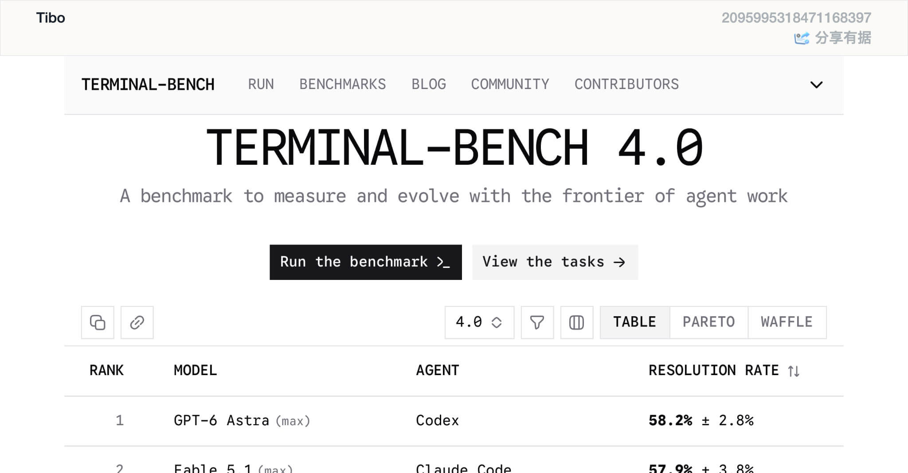
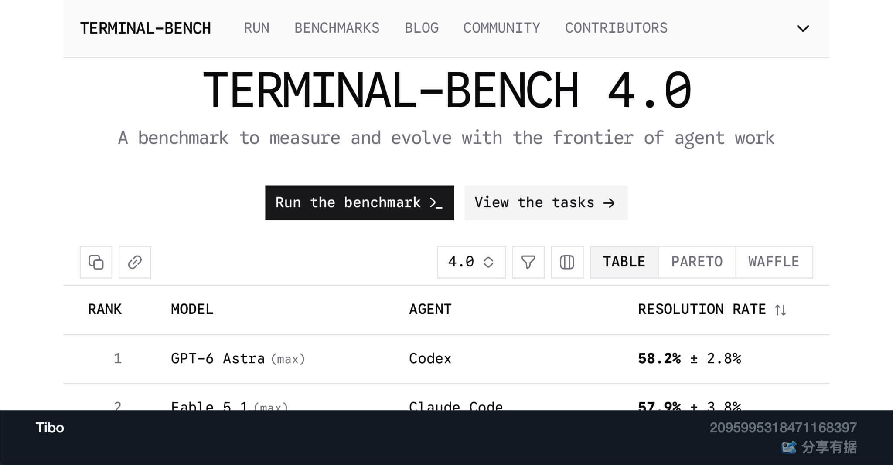
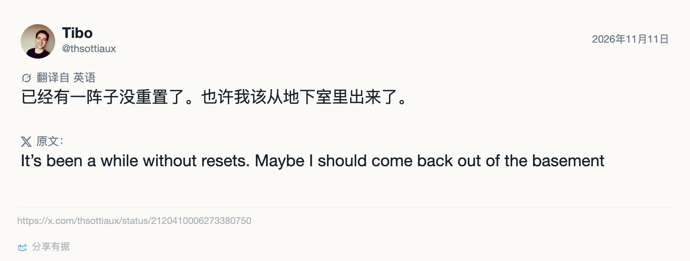
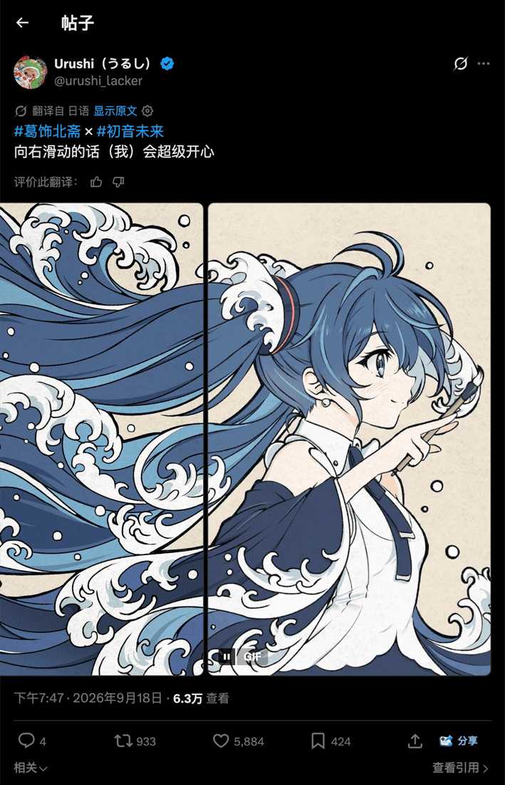
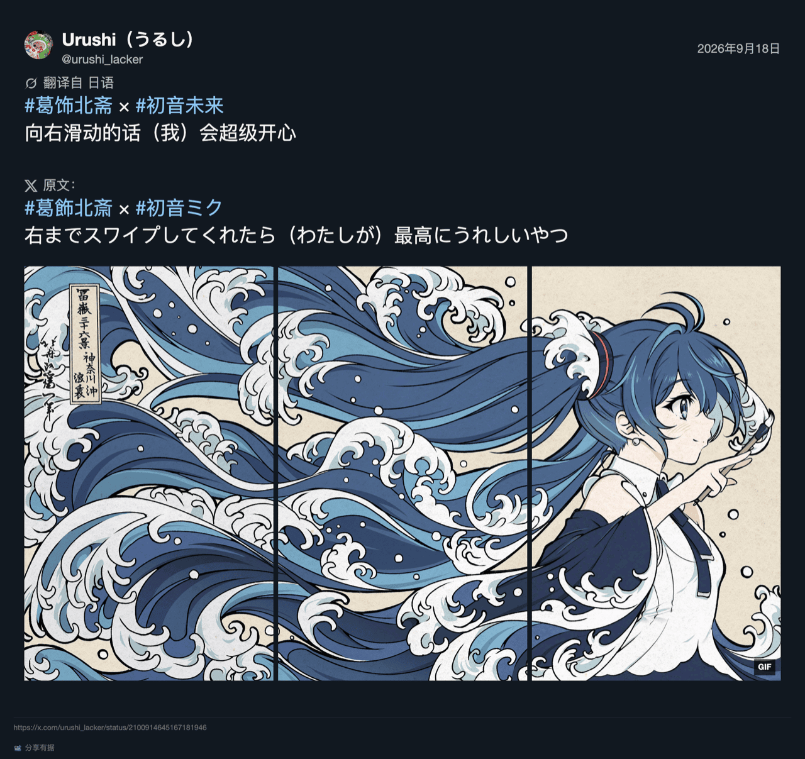
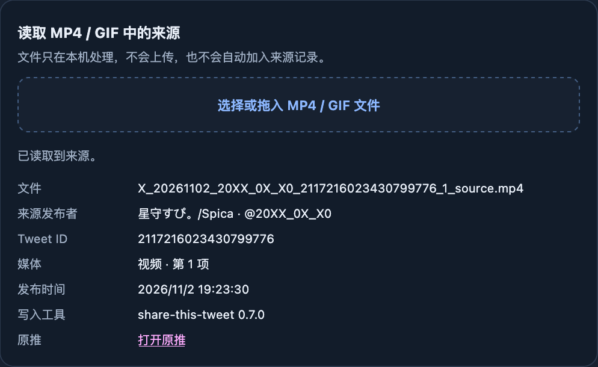

# 功能介绍

分享有据把 X 推文中的文字、图片和视频整理成可保存、可分享的文件，并保留作者及原推文链接。它在 Firefox 中运行，导出入口位于推文详情页。

## 图片来源画框

保存照片时，可以直接下载原图，也可以在上方或下方添加来源画框。画框会适配明暗主题，支持透明图片；文字、头像与默认位置可在设置中调整。

| 上方画框                                             | 下方画框                                            |
| ---------------------------------------------------- | --------------------------------------------------- |
|  |  |

画框右侧保留推文的数字 ID 和扩展标识，左侧可显示账号、署名或发布时间。

## 单行画廊拼接

作者把一幅作品分成多张上传时，可以将整条推文的媒体按原顺序横向拼接。各项统一高度、等比缩放，不裁切；可选择无缝连接或画廊间隔，也可给整张拼图添加一次来源画框。

照片拼图输出静态图片。含视频或 GIF 的动态拼图由[实验性功能](experimental.md)提供。

## 推文卡片

卡片把作者、正文、发布时间、媒体预览和来源链接保存在一张 PNG 中。纯文字推文也能导出；引用推文支持一层引用。

X 已提供译文时，卡片会同时保留原文和译文。投票会保留可见的选项、投票状态及结果。

卡片始终是静态图片——视频使用封面、播放标记和已知时长，GIF 使用静态预览和类型标记。完整视频或动图需另行保存。

除了默认的网格排列，还可以保存单行卡片，将正文和横向媒体放在同一张图里，以便于适配这样的画廊推文。

| X 中的原始画廊                                                | 单行推文卡片                                                  |
| ------------------------------------------------------------- | ------------------------------------------------------------- |
|  |  |

画廊和拼图示例来自 [Urushi（うるし）@urushi_lacker](https://x.com/urushi_lacker/status/2100914645167181946)。

## 视频与 GIF 保存

普通视频可保存为 X 提供的 MP4，也可以把来源发布者和原推链接写入文件元数据字段内。写入来源不添加水印，不改变普通视频的画面和声音，也不重新压制。

X 的 GIF 媒体以 MP4 提供。扩展默认在本机转为真正的 `.gif`，保留动画并循环播放；也可以关闭转码，直接保存 MP4。GIF 转码属于独立的[实验性功能](experimental.md#gif-本地转码)。

已写入来源的 MP4 或 GIF，可以在设置页中读取来源并打开原推。文件只在本机读取，不会上传。

## 复制文字与自定义模板

复制推文时，可以组合原文、译文、投票、作者和链接。内置「双语与来源」「原文与来源」预设，也可以自行编写模板。

画框内容与文件命名同样支持预设和模板。设置页提供变量指南、快捷插入和预览，详见[设置](settings.md)。

## 后台导出与来源记录

保存媒体、画框、拼图和卡片都会加入后台队列，不必打断浏览。确认入队后，可以离开原推文，在任务页查看进度、取消、重试或保存文件。

来源记录单独保存在本机，可按作者、推文 ID 或文件名查找，也可导入导出备份。任务缓存、来源记录和设备里已下载的文件分别管理，清理任务不会删除来源记录或下载文件。操作见[使用](usage.md)。

保留来源有助于追溯出处；分享作品时仍需尊重作者的授权与署名要求。
