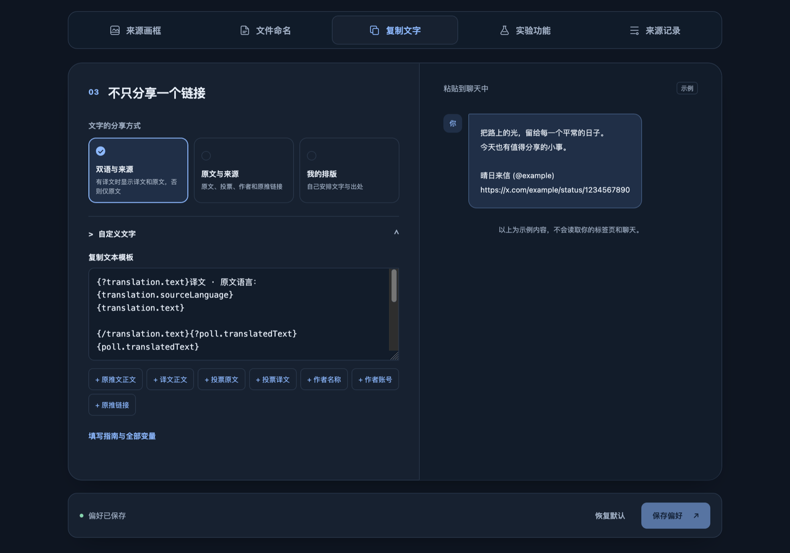

# 设置

从 Firefox 的扩展菜单打开「分享有据」，点击「打开设置」。设置页提供来源画框、文件命名、复制文字、来源记录和实验性功能。

## 保存与生效

画框、文件名、复制模板及实验选项的修改先保留在当前草稿中，点击「保存偏好」后才会生效。保存后重新打开导出面板就能使用新的偏好；已加入队列的任务仍保留提交时的配置。

实验任务在开始处理时还会检查开关：任务仍在排队期间关闭对应功能，会阻止尚未开始的转码，已经开始的处理可继续或手动取消。

「恢复默认」会重置当前草稿中的模板、画框位置、拼接样式和实验选项，仍需点击「保存偏好」。它不改变当前语言，也不会清空来源记录。

## 界面语言

可在扩展弹窗或设置页选择简体中文、English 或跟随浏览器。语言选择立即保存，已打开的扩展界面会同步切换。

界面语言不会改写推文原文或自定义模板。内置默认复制模板可随语言切换。

## 来源画框

### 内容与位置

新配置默认在图片下方添加画框，左侧仅显示账号。可选择以下预设：

| 预设                 | 左侧内容                            |
| -------------------- | ----------------------------------- |
| 仅账号               | 推主的 @账号                        |
| 头像与署名           | 头像、显示名称和 @账号              |
| 头像、署名与发布时间 | 头像与署名，第二行显示 UTC 发布时间 |

默认画框位置可选上方或下方，导出面板中也可以为本次操作选择位置。模板只控制左侧内容；右侧的纯数字推文 ID 和扩展标识固定显示。

自定义文字支持换行，长行按图像宽度自动折行。头像变量仅在画框中渲染为头像，不支持作为复制文字或文件名中的图像使用。

### 画廊媒体样式

「无缝连接」让相邻素材紧贴；「画廊间隔」在素材间保留随主题变化的间距，更加接近 X 原版的画廊效果。默认使用无缝连接。

## 文件命名

内置「按日期归档」「账号与编号」「仅编号」三种预设。默认模板包含 UTC 日期、账号、推文 ID、媒体序号和扩展名：

```text
X_{tweet.publishedAt:YYYYMMDD|undated}_{author.handle}_{tweet.id}_{media.index}.{extension}
```

例如，日期为 2026 年 9 月 8 日、账号为 `example`、推文 ID 为 `1234567890` 的第一项 JPG，可得到 `X_20260908_example_1234567890_1.jpg`。日期缺失时使用 `undated`。

保存时会清理文件名中的非法字符，并按实际输出类型确定扩展名；画框、卡片、拼图和写入来源的文件会添加相应后缀。导出前可在面板中查看本次输出文件名。

## 复制文字

「双语与来源」在 X 提供译文时保留译文和原文，没有译文时保留原文；「原文与来源」只保留原文。两种预设都包含投票、作者和原推链接，并保留一层引用内容。

选择自定义模板后，可以调整正文、译文、投票和来源的排列。没有显式使用引用变量或引用区块时，复制结果会自动追加一层引用；一旦写入这些变量，引用内容由模板控制。



## 编写模板

建议先选择接近需求的预设，再展开自定义编辑器。点击常用变量，或在填写指南中搜索变量，将它插入光标位置。预览可切换普通推文、有引用、有译文、无媒体或缺少可选字段等场景。

### 变量范围

| 编辑器   | 可用内容                                                                  |
| -------- | ------------------------------------------------------------------------- |
| 来源画框 | 作者名称、账号、ID，推文 ID、发布时间、链接，媒体序号与类型，以及作者头像 |
| 文件命名 | 作者名称、账号、ID，推文 ID、发布时间，媒体序号与类型，以及输出扩展名     |
| 复制文字 | 正文、译文、投票、作者、推文及引用信息；不提供媒体变量和输出扩展名        |

填写指南列出当前编辑器的全部可用变量。保存引用推文中的媒体时，画框和文件名里的推文、作者变量指向这项媒体所属的推文。

### 常用写法

直接插入变量：

```text
{author.name} (@{author.handle})
```

字段缺失时使用默认值：

```text
{author.name|未知作者}
```

只有字段有值时才显示一个区块：

```text
{?tweet.publishedAt}发布于 {tweet.publishedAt:YYYY-MM-DD}{/tweet.publishedAt}
```

日期格式支持 `YYYY-MM-DD`、`YYYYMMDD` 和 `YYYY-MM-DD HH:mm:ss`，统一使用 UTC。缺失变量通常展开为空字符串；`0` 和 `false` 仍算有值。可选区块不能嵌套，字面花括号与默认值中的 `|` 不支持转义。

模板包含未知变量、当前编辑器禁用的变量或错误语法时，需要先修正。已保存的自定义模板会保留原文；若旧模板已不符合变量范围，设置页和相关导出操作都会提示错误，可修改模板或重新选择预设。

## 来源记录

「来源记录」管理已保存的推文与输出说明，可搜索、查看、删除，以及导入导出 JSON。记录不包含媒体文件，也不包含这页的偏好设置。

读取文件来源、备份与清理的具体操作见[使用](usage.md#查找与备份来源)。扩展不提供云同步，所有记录均存储在本机；来源记录、任务缓存和已下载文件分别管理。

## 实验性功能

当前版本提供了两个实验性功能，均依赖于随包分发的 FFmpeg wasm，GIF 本地转码默认开启，动态拼图与视频画框默认关闭。调整前请阅读[实验性功能](experimental.md)中的输出规则与限制。
