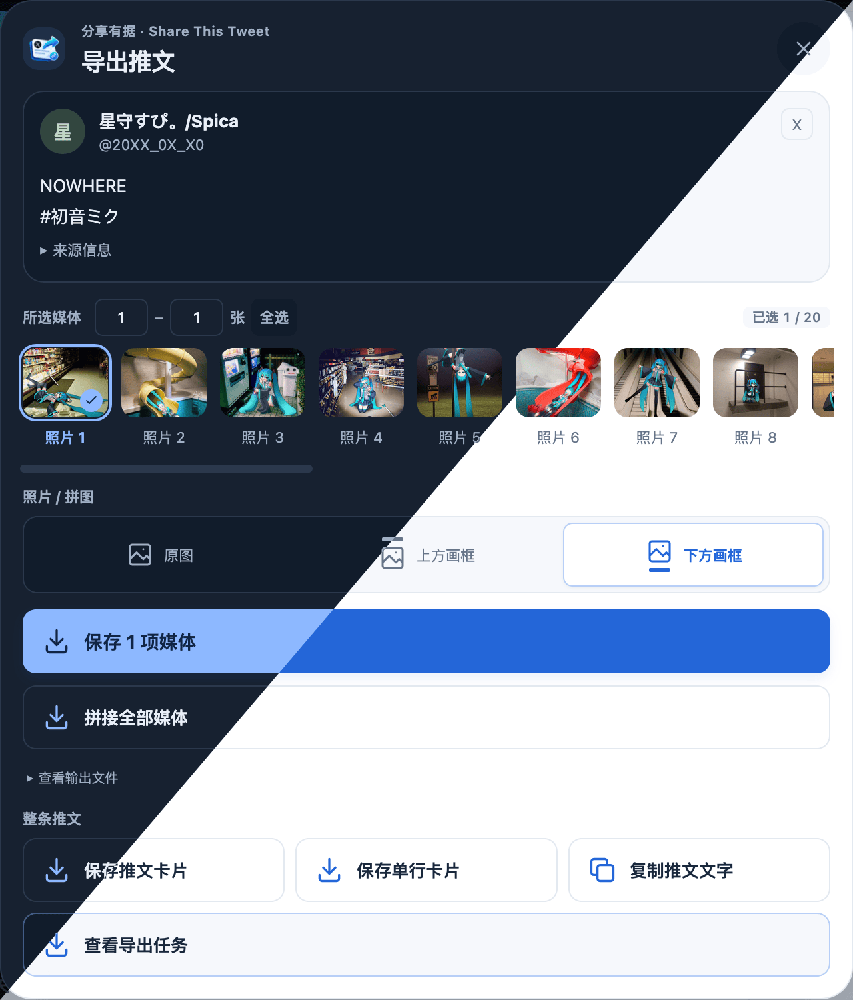

# 使用

## 打开面板与选择内容

在 Firefox 中进入 X 推文详情页，点击「分享有据」的导出入口。时间线和搜索结果中不显示该入口；安装时已经打开的页面需要刷新。

点选媒体缩略图，可以选择一项或多项。有引用推文时，切换「主推文 / 引用推文」，分别选择和保存其中的媒体。

| 操作                   | 使用的内容                       |
| ---------------------- | -------------------------------- |
| 保存 N 项媒体          | 当前选择的媒体                   |
| 拼接全部媒体           | 当前推文的全部媒体，忽略勾选     |
| 保存网格卡片、单行卡片 | 整条推文及一层引用，忽略媒体勾选 |
| 复制推文文字           | 整条推文及一层引用，忽略媒体勾选 |

手机上推文预览默认折叠，保存等操作固定在面板底部。

## 保存照片、视频与 GIF

1. 选择需要保存的媒体。
2. 为照片选择原图、上方画框或下方画框；为普通视频选择原文件或写入来源。GIF 可独立选择是否写入来源。
3. 需要核对命名时，打开「查看输出文件」。
4. 点击「保存 N 项媒体」，等待加入队列的确认。

普通视频的「原文件」保存 X 提供的 MP4。「写入来源」在文件中保存发布者和原推链接，不加水印，也不重新压制普通视频。此方式支持常见 H.264 MP4，可含 AAC 音频，默认下载保护上限为 512 MiB；触发后可强制重试，格式不支持时可改选原文件。

GIF 默认在本机转为 `.gif`。关闭转码或超出转码限制时，会保存原始 MP4；超限会说明原因，转码失败会报错。GIF 不提供来源画框。普通视频的上方／下方画框需要开启[实验性动态处理](experimental.md#动态拼图与视频画框)。

## 拼接全部媒体

在「照片 / 拼图」中选择原图、上方画框或下方画框，再点击「拼接全部媒体」。拼接始终处理当前推文的全部媒体，顺序与原推文一致。

只有照片时输出静态拼图。含 GIF 或视频时，需要开启动态处理，具体时长、声音和超限行为见[实验性功能](experimental.md)。静态输出缺少必要预览时会报错，不会跳过该项。

## 保存卡片与复制文字

选择保存网格卡片或单行卡片，将正文、作者、媒体预览和来源一起保存。卡片固定输出静态 PNG；其中的视频和 GIF 只保留预览，不能播放。

复制推文文字会直接写入剪贴板，不经过后台队列。需要双语内容时，先在 X 中点击翻译；X 提供译文后，面板无需刷新即可更新。扩展不会主动请求翻译，没有译文时保留原文。

卡片和文字会保留 X 已提供的投票信息。未投票且结果不可见时，只导出可见选项和状态。

复制格式由[设置](settings.md#复制文字)中的模板决定。复制后可粘贴到目标应用，保存的图片和视频可从该应用中选择发送；扩展当前不提供系统分享按钮。

## 查看与保存导出任务

点击导出时，会根据已有尺寸、视频时长等信息检查保护限制。预计超限会在当前面板提供「仍然执行」和「取消」；确认仅对这一次任务放宽保护限制，不改变偏好设置。需下载或探测后才能确定的限制，会在任务中提供「强制重试」。

保存媒体、画框、拼图和卡片后，先等待面板显示「已加入队列」，再离开原推文。扩展弹窗和导出面板都提供「查看导出任务」入口。

任务按创建时间倒序排列，可按保存状态和本地创建日期筛选。点击任务标题打开原推文，展开任务可查看各个文件的状态，以及保存、重试和诊断操作。

### 桌面 Firefox

处理完成后自动下载，只有浏览器确认下载完成才标记文件已保存。保存失败时，已生成的文件会暂存在缓存中，可从任务页手动补存。

桌面下载等待超过 30 分钟会提示下载未完成，并尝试取消该次下载；已生成的文件仍可补存。若取消失败，先检查浏览器下载列表，再决定是否重试，避免重复下载。

### Android Firefox

首次提交任务时会打开独立任务页，后续提交复用该页，不切换到前台。保留任务页，处理完成后手动保存输出文件。

「已发起下载」只表示向浏览器提交了请求，不能确认文件最终保存成功或用户是否取消。请检查设备的下载目录；未收到文件时，展开任务选择再次保存。浏览器可能逐个要求确认，批量保存期间也需要保留任务页。

### 批量保存

页面顶部的保存全部操作针对**所有任务中的待保存文件**，不受当前筛选影响；任务内部的保存按钮只处理该任务。

批量保存按点击时的文件列表逐个进行，跳过处理中、已保存／已发起下载及过期文件。可停止后续下载；接口报错时也会停止并提示。Android 请求之间约有一秒间隔。

## 取消、中断与重试

任务串行处理，同一时间只运行一个。多项媒体中某一项失败，不会阻止其余项尝试输出；已有有效文件时标记「部分完成」，详情列出未完成项；保护限制标记「达到保护限制」，没有有效输出且发生实际处理错误时标记「失败」。

排队或处理中的任务可以取消。关闭原推文不会取消已经入队的任务；关闭浏览器、重新加载扩展或系统回收进程会中断处理。扩展重新启动后，未开始的任务继续排队，已中断的任务需手动重试。

普通重试会重新处理，不从视频编码中途恢复，并跳过已成功保存输出的再次下载。强制重试创建独立任务，保留原任务和文件，绕过可放宽的尺寸、容量、时长与帧率保护；格式、链接安全及数据完整性检查仍然执行。Android 后台运行仍受系统限制，保留任务页也不能保证进程始终存活。

## 缓存期限与清理

任务、生成文件和诊断保存在本机。文件过期后不能继续下载，未保存的输出可通过重试重新生成。

| 内容                       | 保留期限           |
| -------------------------- | ------------------ |
| 桌面已确认保存的媒体缓存   | 立即释放           |
| 桌面生成但未成功保存的媒体 | 生成后 24 小时     |
| Android 已点击保存的媒体   | 点击保存后 24 小时 |
| Android 尚未保存的媒体     | 生成后 7 天        |
| 动态处理诊断               | 最后更新后 7 天    |
| 已结束任务及其快照         | 结束后 30 天       |

桌面文件保存成功后，任务页不能直接再次下载该文件，需要从推文重新导出。浏览器关闭期间不会清理，下次启动时补清；短期大量导出仍可能用满浏览器存储空间。

任务页提供两个手动清理入口：

- **清除缓存**：删除已结束任务的输出文件和诊断，保留任务记录、文件名与保存状态。
- **清除任务历史**：同时删除已结束任务的记录、输出文件和诊断。

两者都作用于全部已结束任务，不受筛选影响，并跳过排队、处理和正在保存的任务。尚未保存的文件清除后需要重新导出；已下载到设备的文件和设置页中的来源记录不会被删除。

## 查找与备份来源

进入设置的「来源记录」，按推文 ID、作者或文件名搜索，选择一条记录查看原推链接和输出说明。

点击「导出 JSON」备份记录；换设备时可在新设备中使用「导入 JSON」。此备份只包含来源及输出记录，不包含媒体文件或偏好设置。删除一条记录会同时删除它的输出说明；清空记录不会删除设备中的媒体文件。

需要从文件追溯来源时，在同一页面选择或拖入本扩展写入过来源的 MP4 或 GIF。默认读取上限为 2 GiB，超限或处理超时后可在原位置强制重试。读取在本机完成，不会上传，也不会自动加入来源记录。

其他平台转码可能移除文件中的来源信息。

## 遇到问题

找不到导出入口时，先确认是在 Firefox 的 X 推文详情页，再刷新页面。复制内容缺少译文时，先检查 X 是否已提供翻译。

导出失败时，展开任务查看具体错误。动态处理失败或性能异常时，可以下载诊断；来源文件读不出记录时，也可能是文件没有写入来源，或已被其他工具移除。

仍无法解决的问题可在 [Issues](https://github.com/star-whisper9/share-this-tweet/issues) 反馈，附上操作步骤、Firefox 版本和任务错误；动态处理问题可附诊断 JSON。反馈前可先查阅 [ChangeLog](../changelog.md)。
